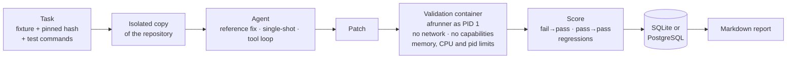
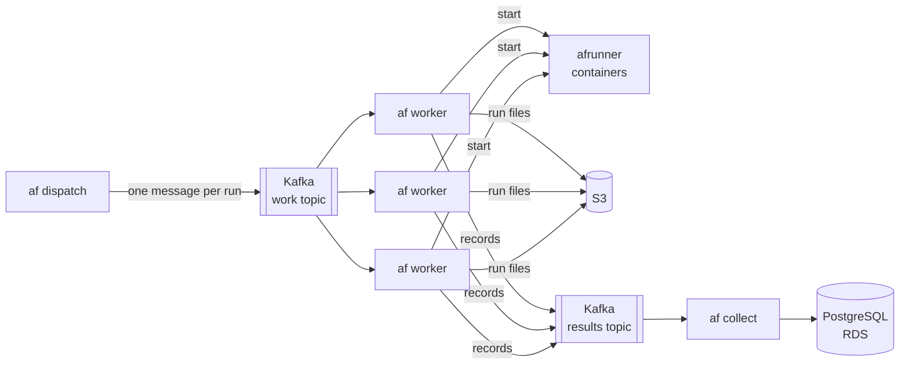

# AgentFoundry

**A test harness for AI coding agents.** AgentFoundry gives an agent a coding
task, runs the agent's patch against the repository's own tests inside a
locked-down container, and records what happened: which tests now pass, which
ones broke, how long the agent took, and how many tokens it used.

[](https://github.com/Manideep728/agent-foundry/actions/workflows/ci.yml)


## Results

Five configurations, three repeats each, on one machine: an RTX 4060 with
8 GiB under WSL2, with every model served locally by Ollama. The per-run tables
are in [examples/report.md](examples/report.md), which `af report` generated
from the database these runs were stored in.

| Agent | Model | Suite | Resolved | Broke a passing test | Median agent time | Median tokens per run | Cost |
|---|---|---|---|---|---|---|---|
| Reference fix | none | synthetic, 8 tasks | 24/24 | 0/24 | | | $0 |
| Single-shot | qwen2.5-coder:7b | synthetic | **15/24** | 3/24 | 6.8 s | 1,177 | $0 (local) |
| Tool loop | llama3.2:3b | synthetic | **0/24** | 15/24 | 26.1 s | 6,829 | $0 (local) |
| Reference fix | none | real repositories, 5 tasks | 15/15 | 0/15 | | | $0 |
| Tool loop | llama3.2:3b | real repositories | **0/12** | 0/12 | 57.8 s | 23,623 | $0 (local) |

- **The reference fix is not an agent.** It applies each task's known-correct
  fix, and the harness then validates that patch like any other. A full score
  shows that every task can be solved inside the harness, so a model that
  scores zero failed on its own.
- **qwen2.5-coder:7b**, given the whole small repository in one prompt, solves
  5 of the 8 synthetic tasks, and the same 5 in every repeat.
- **llama3.2:3b with tools** writes patches on the synthetic suite, and every
  one breaks a test that passed before. On the real repositories it reads files
  and never writes a fix. Three more runs, all of `pallets-flask-5063`, have no
  measurement: one model call ran past the 900 s limit each time. The report
  lists them with that reason instead of counting them as failures.
- **Repeats agree.** At temperature 0, every task in all five configurations
  gave the same outcome, the same patch, and the same token count on every
  model call, in all three repeats.
- **No hosted model is in the table.** The OpenAI-compatible client works with
  any chat-completions server, but it has only been run against a local one.

## Harness numbers

| | |
|---|---|
| **No lost work** | A worker killed with `SIGKILL` mid-suite: **64 of 64** runs stored, each exactly once |
| **Scales out** | **2.5x** throughput with 4 workers (104 to 255 runs per minute) |
| **Cheap isolation** | The C++ supervisor as PID 1 adds **3 ms or less**; the container adds about 400 ms |
| **Deployed** | ECS, RDS and S3 on AWS with Terraform: deploy, measure 16 runs and destroy in **11 minutes** |
| **Tested** | **1,155** Python tests and **146** C++ tests, in 4 CI jobs with real Docker, Kafka and PostgreSQL |

## How it works



1. **Load the task.** The fixture is checked against the content hash the task
   pins, and a fixture that changed is refused.
2. **Run the agent** on a copy of the repository, never the fixture itself, and
   capture its patch.
3. **Validate the patch.** `afrunner`, a C++20 supervisor, runs the
   repository's own tests as PID 1 of a container with no network.
4. **Score and store.** A task is resolved when its failing tests now pass and
   no passing test broke. Each run records its tokens, cost, durations, image
   digest and harness build.

## Quick start

Needs Linux or WSL2, Docker and [uv](https://docs.astral.sh/uv/).

The default agent calls no model: it applies the task's known fix, so this runs
offline and shows the pipeline working end to end.

```
$ make runner-image
$ uv run af run tasks/csv-quoted-fields.toml
run 20261115-111315-bc3b1a90  csv-quoted-fields  [synthetic]
  state       scored
  outcome     clean_patch
  resolved    yes         regressed   no
  fail->pass  1/1          pass->pass  1/1
  duration    agent 1ms   validation 755ms
  cost        0 micro-USD  (fake/scripted)
  patch       1391 bytes
  runner      afrunner in docker image afrunner:local  pid1=True arch=x86_64
  image       sha256:bd18b244cf5e2c29f9d4eeeb834c4953aecf0b857f8c1347eecf0f52758a38dc
  workspace   runs/20261115-111315-bc3b1a90
```

The same task with a real model, served by a local Ollama:

```
$ uv run af run tasks/interval-merge.toml --agent single-shot --model qwen2.5-coder:7b
run 20261115-111316-037fea04  interval-merge  [synthetic]
  state       scored
  outcome     clean_patch
  resolved    yes         regressed   no
  fail->pass  1/1          pass->pass  1/1
  duration    agent 10646ms   validation 1941ms
  cost        0 micro-USD  (ollama/qwen2.5-coder:7b)
  patch       354 bytes
  runner      afrunner in docker image afrunner:local  pid1=True arch=x86_64
  image       sha256:bd18b244cf5e2c29f9d4eeeb834c4953aecf0b857f8c1347eecf0f52758a38dc
  workspace   runs/20261115-111316-037fea04
```

`af bench` runs every task in a directory and prints one summary per suite;
`--repeats N` runs the suite N times and checks that the repeats agree.
`af report --out report.md` writes the Markdown report over every stored run.
`af list` and `af show <run-id>` reprint stored runs.

The exit code tells a script whether a measurement exists, so nothing has to
parse the output:

| Code | Meaning |
|---|---|
| 0 | a measurement exists, whatever it says about the agent |
| 1 | the harness failed, so there is no measurement |
| 2 | usage error |
| 130 | interrupted |

## Tasks

**Synthetic suite.** Eight small Python repositories in `tasks/fixtures/`, each
with one bug or missing behaviour. A task file pins its fixture by content hash
and names the commands that grade it:

```toml
[task]
id = "csv-quoted-fields"
suite = "synthetic"
...
[fixture]
id = "csv-quoted-fields"
sha256 = "96265f3e1e6ff2e3346ec618820b5f787b3d39052116d496703c953e6b0cc245"
...
hidden_paths = ["tests/test_quoting.py"]
...
[[commands]]
role = "fail_to_pass"
command = "python3 -m unittest tests.test_quoting"

[[commands]]
role = "pass_to_pass"
command = "python3 -m unittest tests.test_basic"
```

`hidden_paths` keeps the grading test out of the agent's prompt and tools. It
is still copied and still run.

**Real-repository suite.** Five [SWE-bench Lite](https://www.swebench.com/)
instances. Each task runs in the instance's own published image, mounted where
that image expects its source. The agent works on the repository at the
issue's commit, and the tests that grade it are added only after it finishes,
the same way SWE-bench's own harness does it.

```toml
[task]
id = "pallets-flask-4045"
suite = "oss"
...
[environment]
base_image = "swebench/sweb.eval.x86_64.pallets_1776_flask-4045@sha256:1425b0801ddf4b2607e552e56516cce3d389bab0a3ce06f58e6fa6a7835c703c"
image = "afrunner-oss:pallets-flask-4045"
workdir = "/testbed"
```

The five were picked by
[a rule committed before any instance was checked](docs/DECISIONS.md#d40--five-swe-bench-lite-instances-chosen-by-a-rule-fixed-before-any-run):
take requests, flask, pytest and pylint in turn, and from each, its next
instance that passes an oracle check. The reference fix must resolve 3 of 3
runs, the untouched repository must resolve 0 of 3, and every command must
finish in under 60 s with no network. Every requests instance failed, because
its tests need the network. Every pylint instance failed, because its source
tree has a file name the fixture manifest does not accept. That leaves three
flask tasks and two pytest tasks.

The fixtures are not in the repository. `af fetch` pulls each image by digest,
copies its source tree out, checks it against the pin, and builds the
validation image. That needs the network and several GB per task:

```
$ uv run af fetch tasks/oss
$ uv run af run tasks/oss/pallets-flask-4045.toml
run 20261115-111353-eb5540d8  pallets-flask-4045  [oss]
  state       scored
  outcome     clean_patch
  resolved    yes         regressed   no
  fail->pass  1/1          pass->pass  1/1
  duration    agent 2ms   validation 1013ms
  cost        0 micro-USD  (fake/scripted)
  patch       1354 bytes
  runner      afrunner in docker image afrunner-oss:pallets-flask-4045  pid1=True arch=x86_64
  image       sha256:019c80e2ec574ac590b886eaf4291251480adcb6b3e249ed41f99eaff4eedb86
  workspace   runs/20261115-111353-eb5540d8
```

`af import-swebench <instance-id>` writes the task file, test patch and
reference fix for another instance, from a downloaded SWE-bench Lite JSONL file.

## Agents and models

- `--agent fake`, the default, applies the known fix from `tasks/solutions/`
  and calls no model.
- `--agent single-shot` sends the task and every visible file in one prompt,
  and applies the files the model sends back.
- `--agent tools` gives the model tools and a budget of turns (`--max-turns`).
  The `tools-v2` prompt offers list, read and write. `tools-v3`, for real
  repositories, adds a directory listing, a text search and line-range reads.

`--provider ollama` is the default. `--provider openai-compat --base-url URL
--api-key-env NAME` reaches any server with the OpenAI chat-completions API.
The key is read from the named environment variable, never from the command
line, and a test checks that it appears nowhere in the database or in a run's
files. When a server rate-limits, the client waits as it is told, a bounded
number of times, and the wait is recorded apart from the model's own time.

Every run records the agent, provider, model and prompt, and every model call
records its tokens and latency. Calls run at temperature 0 with a fixed seed.
With Ollama, each call also starts from an unloaded model, because a reply can
otherwise depend on what an earlier request left in the server's cache; the
recorded time includes that load. A prompt is a named, frozen variant: changing
its text fails a test, so a new prompt gets a new name and its own row in a
report. A reply that cannot be read as an edit is scored `malformed_output`,
because failing the output format is something a model does, and it is
measured like everything else it does.

## What makes the numbers trustworthy

- **A supervisor, not a shell script.** `afrunner` runs as PID 1 inside the
  container. It runs each test command in its own process group with its own
  deadline and a total deadline, escalates from `SIGTERM` to `SIGKILL`, and
  reaps orphaned processes. A command killed by the memory limit is reported as
  a harness failure, never as a failing test.
- **Structured results, not log scraping.** The runner writes a `result.json`
  with each command's exit code, signal, duration and capped output, and the
  control plane reads that file, never the container's output. A conformance
  test runs the real binary and reads its output through the Python types.
- **Pinned inputs and a recorded environment.** A fixture whose hash changed is
  refused, and runs only ever touch a copy. Each run records the image digest,
  the architecture, whether the supervisor was PID 1, and the harness build.

`make doctor` checks that this machine's Docker enforces the limits the harness
asks for:

```
$ make doctor
uv run af doctor --image afrunner:local
PASS  runtime     server 29.1.3, cgroups v2, x86_64
PASS  image       afrunner:local: afrunner 0.1.0
PASS  pid1        pid1=True, shell /usr/bin/dash
PASS  network     1.1.1.1:53 blocked
PASS  memory      512 MiB under a 67108864-byte limit: kill detected
PASS  pids        --pids-limit 1: fork: Resource temporarily unavailable
INFO  bind        200 small files written to /work in 2 ms
```

What the isolation costs, over 40 runs of each arm for the two commands of
`semver-compare`:

| Arm | p50 | p95 |
|---|---|---|
| Container, supervisor as PID 1 | 461 ms | 482 ms |
| Container, `/bin/sh` as PID 1 | 464 ms | 481 ms |
| Host, no container | 60 ms | 62 ms |

The supervisor adds no time this measurement can find: the difference is 3 ms
or less and its sign changes. The container adds about 400 ms per validation.

## Distributed and on AWS



Workers take runs from Kafka, validate each in its own container, and publish
the result. A collector stores every result in one SQLite or PostgreSQL
database. Kafka can deliver a run twice, so the dispatcher sets each run's ID:
a worker that receives a run it already stored republishes the stored record
instead of measuring again, and the collector keeps the first copy. A worker
that dies never acknowledges its run, so Kafka hands it to another worker. Each
container is labelled with its run and with the database that started it, so a
restarted worker removes only its own leftovers, never another worker's live
container. Kafka is an optional extra; `af run` and `af bench` do not need it.

```
make kafka-up
uv sync --extra kafka
uv run af dispatch --agent fake
uv run af worker --agent fake --worker-id w1 --db worker.sqlite3 --idle-exit-s 10
uv run af collect --db pool.sqlite3 --idle-exit-s 5
uv run af report --db pool.sqlite3 --out -
```

`make fanout-check` measures the suite once with `af bench` and once through
two workers and a collector, and passes only when the per-task results are
identical. CI runs it with a SQLite and with a PostgreSQL collector. `--db`
takes a `postgresql://` URL in every command; give the password in
`PGPASSWORD`.

On one machine (24 CPUs, WSL2, a local broker, the reference fix, real Docker
validation), each trial measured 64 runs; the table shows the median of three
trials:

| Workers | Runs per minute | Speedup |
|---|---|---|
| 1 | 104 | 1.0x |
| 2 | 170 | 1.6x |
| 4 | 255 | 2.5x |

In one trial a worker was killed with `SIGKILL` after five runs. Kafka moved
its partitions to the other worker after the 45 s session timeout, and the
collector stored 64 of 64 runs, each once.

`infra/aws/` deploys the same layout with Terraform: ECS on one EC2 instance
for the broker, the collector and two workers, RDS PostgreSQL for the results,
S3 for each run's files, ECR for the images, and a budget alarm. Workers start
the runner through the instance's Docker socket, which Fargate does not offer.
`infra/aws/smoke.sh` builds from `HEAD`, deploys, dispatches the suite twice,
stops a worker, checks that every run is in RDS exactly once with its files in
S3, then destroys everything and checks that nothing is left. One run took 11
minutes and stored 16 of 16. Its suite most likely finished before the worker
stopped, so it does not show redelivery; the local trial above does.

## Build and test

```
make sync          # create the virtualenv
make check         # lint, type check, tests
make runner-test   # build afrunner and run its C++ tests
make runner-image  # build the validation image, afrunner:local
```

Tests that need Docker, Kafka or PostgreSQL skip and say so when those are
missing. CI runs four jobs: the control plane; the runner and its container
tests, also under `docker run --init`; Kafka with `make fanout-check`; and
PostgreSQL. Tests that call a real model are skipped in CI, which has no model
server.

## Limitations

- **Not a sandbox for hostile code.** Docker reduces accidental access to the
  host. It is not a hardened boundary against a workload written to escape it.
- **Small samples.** Eight synthetic tasks and five real ones, from two
  repositories. The prompts were tuned on the synthetic suite, so its figures
  are an upper bound for unseen tasks.
- **Linux only.** The supervisor depends on POSIX process semantics.
- **Reproducible here, with local models.** Repeats agree on one GPU with one
  Ollama build. Another GPU or build can compute different results, and a
  hosted model cannot be held to this at all, which is why every run records
  its environment.

Operational notes, such as long model calls, tool calls written as text, rate
limits and leftover containers, are in
[docs/TROUBLESHOOTING.md](docs/TROUBLESHOOTING.md).

## Documentation

- [docs/DECISIONS.md](docs/DECISIONS.md): each design decision, the options,
  and why.
- [docs/RUNNER_CONTRACT.md](docs/RUNNER_CONTRACT.md): the supervisor's
  interface.
- [examples/report.md](examples/report.md): the full results behind the table
  above.

## License

MIT. See [LICENSE](LICENSE).
